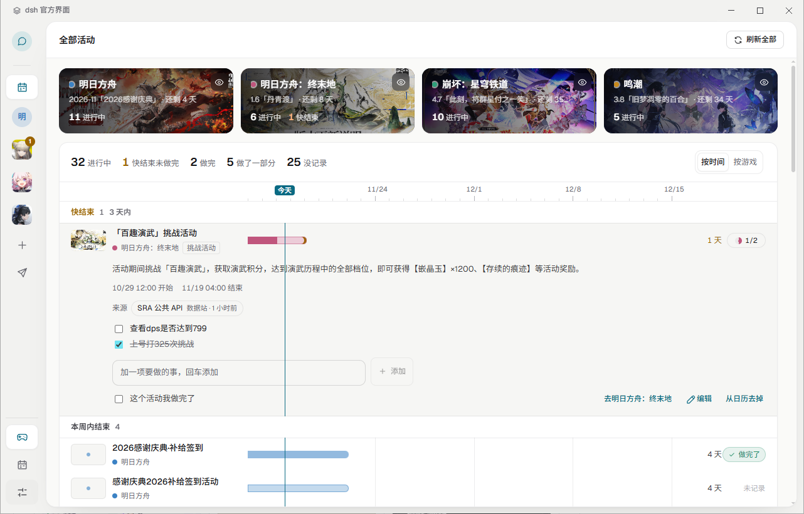
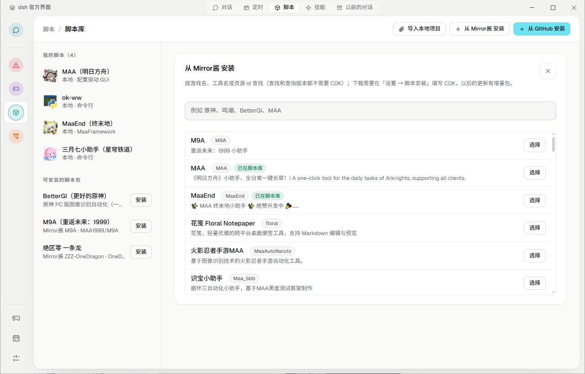
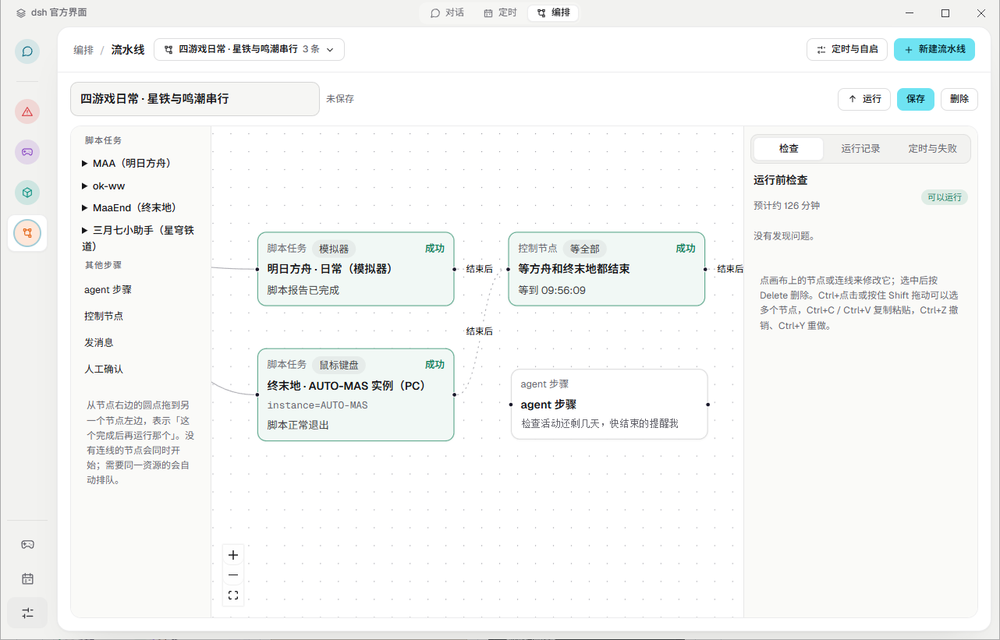
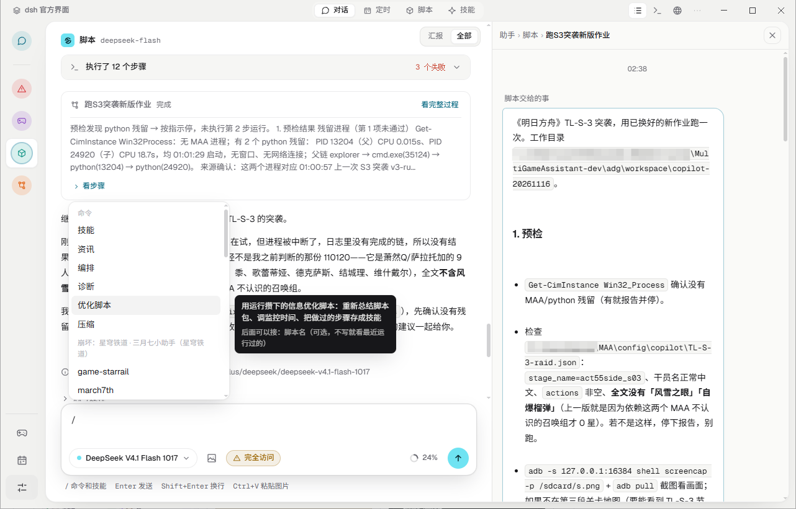

<div align="center">

# 多游戏助手

MultiGameAssistant

让 agent 替你管好各个游戏的日常脚本<br>
安装、配置、定时运行、出错处理、活动提醒，一个软件全包；agent 核心是 [DeepSeek Harness](https://github.com/deepseek-ai/deepseek-harness)。

<p>


<a href="https://www.npmjs.com/package/dsh-multigameassistant"></a>
<a href="https://github.com/haaahhhis/MultiGameAssistant/releases/latest"></a>

</p>

[下载](https://github.com/haaahhhis/MultiGameAssistant/releases/latest) · [技能库](https://github.com/MultiGameAssistant/skills) · [问题反馈](https://github.com/haaahhhis/MultiGameAssistant/issues)

</div>

---

> **关于脚本**：MAA、MaaEnd、三月七小助手等脚本来自它们各自的项目。本软件负责安装、配置、调度和看护，**不修改脚本的代码**；脚本的版权和许可证归原作者所有。
>
> 模型可以自己选：DeepSeek、Claude、ChatGPT、Gemini、国内各家，或者本机的 Ollama。

## 目录

- [简介](#简介)
- [截图](#截图)
  - [活动日历](#活动日历)
  - [脚本库](#脚本库)
  - [流水线编排](#流水线编排)
  - [和 agent 对话](#和-agent-对话)
- [安装](#安装)
  - [桌面版](#桌面版)
  - [已经装了 dsh：装成插件](#已经装了-dsh装成插件)
  - [给 agent](#给-agent)
- [功能](#功能)
  - [脚本](#脚本)
  - [编排与定时](#编排与定时)
  - [监控与干预](#监控与干预)
  - [游戏信息](#游戏信息)
  - [agent](#agent)
  - [QQ 机器人](#qq-机器人)
- [官方脚本包和游戏包](#官方脚本包和游戏包)
- [致谢](#致谢)
- [许可证](#许可证)

## 简介

**多游戏助手**：让 agent 替你管好各个游戏的日常脚本。安装脚本、读懂脚本怎么用、把几个游戏的日常排成每天定时自动跑的流水线、盯着运行出的问题并动手处理、查各游戏的活动和你的进度，再通过 QQ 告诉你结果。

- 只支持 Windows 10 / 11（x64 和 ARM64）。
- 两种用法：独立的桌面版（自带托盘、开机自启、定时唤醒电脑），或者装进已有的 DeepSeek Harness 当插件。

## 截图

### 活动日历

各游戏现在有哪些活动、还剩几天，按时间排在一条时间轴上，快结束还没做完的排在最前面。展开一个活动能看到说明、来源和起止时间，可以加几项自己要做的事逐项勾掉，或者直接标成「做完了」。

<p align="center"></p>

### 脚本库

左边是装好的脚本（头像是脚本程序自己的图标）和可以一键安装的脚本包；也可以导入本地已有的目录，或者在 Mirror酱 上按游戏名、工具名搜索安装，已经在脚本库里的会标出来。

<p align="center"></p>

### 流水线编排

把脚本任务、控制节点、agent 步骤连成一张图：没有连线的同时开始，用同一个模拟器或屏幕的自动排队，「等全部」的控制节点等前面几条分支都结束再往下走。右边是运行前检查（预计用时、有没有问题）、运行记录和定时设置。

<p align="center"></p>

### 和 agent 对话

agent 做的每一步都能展开看；交给脚本 agent 的事（比如用新作业跑一次突袭）在右边看完整过程。输入 `/` 调出命令和技能：编排、诊断、优化脚本、压缩，以及各个游戏和脚本的技能。

<p align="center"></p>

## 安装

### 桌面版

在 [Releases](https://github.com/haaahhhis/MultiGameAssistant/releases) 下载安装包（x64 选 `MultiGameAssistant-Setup-<版本>.exe`，ARM64 选 `…-arm64.exe`）双击安装；或者在 PowerShell 里运行一行命令，自动选好安装包、校验 SHA-256、静默安装并启动：

```powershell
irm https://raw.githubusercontent.com/haaahhhis/MultiGameAssistant/main/scripts/install.ps1 | iex
```

再运行一次就是更新到最新版本（设置和数据都保留）。GitHub 下载慢时加镜像：`$env:MGA_MIRROR='https://ghproxy.net/'; irm … | iex`。

### 已经装了 dsh：装成插件

不用下完整安装包，装成 dsh 插件就行（十几 MB）。插件发布在 npm 上，名字是：

```text
dsh-multigameassistant
```

- **插件市场（推荐）**：在 dsh 的插件市场里搜索 `dsh-multigameassistant` 安装。之后的更新、停用和卸载也都在插件市场里点，不用记命令。
- **dsh 桌面版手动添加**：打开左边的「Plugins」→「Add plugin」，填 `dsh-multigameassistant` →「Install」→「Enable now」。侧边栏会多出「多游戏助手」，点开就是本软件的界面，不用重启。
- **命令行的 dsh**：`dsh plugin add dsh-multigameassistant`，再 `dsh web`，在侧边栏点「多游戏助手」。

npm 慢或连不上时，把上面的名字换成 GitHub 上的插件包链接，它总是指向最新版：

```text
https://github.com/haaahhhis/MultiGameAssistant/releases/latest/download/dsh-multigameassistant.tgz
```

插件和你平时的 dsh 对话互不影响：多游戏助手的对话用它自己的 agent 预设「多游戏助手」，脚本、游戏、编排这些工具和它的提示词、技能、权限设置都只在这些对话里，你别的对话看不到，也不会被它改权限。更新：在插件市场里更新，或者用同样的名字（或链接）再装一次；插件里「设置 → 关于」显示插件的版本，打开时会检查有没有新版本，并告诉你用名字还是用链接装。

和桌面版相比，插件版没有自己的托盘、开机自启和定时唤醒电脑：定时任务在 dsh 开着时执行。

### 给 agent

> 给 agent：用户让你安装这个仓库时，运行上面这条命令即可，不用自己找安装包，也不需要点击安装界面（安装包也支持 `/S` 静默安装，装在当前用户下，不需要管理员）。装好后提醒用户在软件里选模型、填 API key。用户已经在用 dsh、想装成插件时，按「已经装了 dsh」来：dsh 桌面版让用户在 Plugins 页的「Add plugin」里填 `dsh-multigameassistant`（桌面版开着时它自己的 profile 不能从命令行改），命令行的 dsh 用 `dsh plugin add dsh-multigameassistant`；npm 连不上时用 GitHub 插件包链接代替名字。

## 功能

### 脚本

- **一键安装**：从 GitHub 安装有官方脚本包的脚本，可以更新、回滚到旧版本、删除。安装时可以续传、校验、安全解压，缺的运行环境会帮你装好。国内网络可以在「设置 → 脚本安装」里换下载镜像。
- **Mirror酱**：在 [Mirror酱](https://mirrorchyan.com) 发布的脚本（MAA、MaaEnd、三月七小助手、M9A、BetterGI 等）填了 CDK 后从那里更新：国内下载快，只下载改动的文件（增量更新）。CDK 不能用时自动改回 GitHub。
- **本地导入的脚本也能更新**：从目录里认出版本（`interface.json`、版本文件或程序的文件版本），按它的更新渠道（脚本包或已知项目的 GitHub 仓库和 Mirror酱 资源，也可以自己填）检查更新，在原目录里更新：被替换的文件先备份、配置文件不动，可以一键撤销。自己下载的 BetterGI 之类会被认出来，直接走 Mirror酱。
- **从 Mirror酱 直接安装**：按游戏名或工具名搜索（「原神」「鸣潮」…），不用记资源 id，查找不需要 CDK；游戏页也会列出 Mirror酱 上玩这个游戏的工具，脚本页能查一个脚本是否接入了 Mirror酱。
- **任意脚本**：可以导入本地已有的脚本目录。没见过的脚本，agent 先找到并读完项目自己的文档（目录里的说明、仓库 README、Wiki、文档站），再结合代码核对补全，实在没有文档才直接看代码；弄清怎么启动、有哪些任务、配置在哪、日志怎么看后，写成一个「脚本包」直接保存，之后就能像官方脚本包一样使用；它会告诉你依据了哪些文档、哪些还没确认。
- **脚本更新后检查脚本包**：你或 agent 写的脚本包，在脚本更新到新版本后会问你要不要检查（脚本页和 QQ 都会问）。同意后 agent 先读这几个版本的更新日志，只核对受影响的任务、配置和日志，要改的直接改好并告诉你（之前的版本留在历史里）。
- **脚本自带的 MCP 和技能**：脚本目录里有 MCP 配置（`.mcp.json`、`.vscode/mcp.json` 等）时自动读出来，agent 能直接调用脚本 MCP 服务的工具来操控它（查状态、只跑某一项、改设置），不只是运行整个任务；服务用到时才启动，不是官方脚本包描述的会先问你一次。agent 写脚本包时会把 MCP 的用法一起写进去。脚本自带给 agent 的技能（`skills/`、`.claude/skills/` 等处的 SKILL.md）可以在脚本页一键放进技能库，只在处理这个脚本时使用，脚本更新后跟着更新。
- **本地配置副本**：脚本运行时用的是本软件保存的一份配置，你在脚本自己界面里的设置不受影响，也可以一键用原项目的配置覆盖。
- **多份配置**：一个脚本可以存几份配置（比如大号、小号，或者不同的任务组合），可以复制现有的、读取原项目的或从别的文件夹读取。运行和编排时选用哪一份，不选就用「当前使用」的那份。
- **脚本简介**：在脚本页点「让 AI 总结」，agent 会看它的说明、文件和脚本包，用几句话说清楚它是什么、给哪个游戏用、能做什么。
- **模拟器**：自动检测 MuMu 模拟器和它的多开实例，运行前启动好；其他模拟器可以填 ADB 地址。

### 编排与定时

- **流水线画布**：把脚本任务、agent 步骤、等待、发消息、人工确认连成一张图。互不冲突的任务并行跑，抢同一个模拟器或屏幕的自动排队。可以设置失败时重试、跳过或停下，「控制节点」可以等前面的分支全部结束。
- **运行前检查**：画布上直接标出成环、找不到的脚本或任务、参数不对的步骤。
- **定时**：每天定点运行，错过了在宽限时间内补跑，同一天成功过就不再重复，夏令时也不会出错。
- **无人值守**：
  - 开机登录后自动启动，进托盘直接跑；
  - 运行期间不让电脑睡着；
  - 睡眠中按定时唤醒电脑；
  - 跑完后可以关游戏、关模拟器、睡眠或关机。
- 也可以对 agent 说「帮我把这几个脚本排成每天早上跑的流程」，它会先看电脑配置和已有的流水线，再起草一份给你确认。

### 监控与干预

- 运行中出错、失败、卡住或超时，先按脚本包里写好的办法自动处理，例如重跑、等待或重启模拟器。
- 自动处理不了时，脚本暂停，交给 agent。agent 截图看画面，在游戏窗口或模拟器里点击、输入，排除问题后让脚本继续。你也可以只让它诊断、不动手。
- 每一步都有记录，并推送到 QQ。消息下面有按钮，点一下就能停止、继续或回答 agent 的问题。

### 游戏信息

- **活动日历**：各游戏现在有哪些活动、还剩几天、商店换完没有、哪些快结束了还没做。数据有三个来源：
  - 数据站，每天自动读，不花模型调用：[SRA 公共 API](https://starrailassistant.top/reference/public-api/)、PRTS、B 站游戏 WIKI；
  - 网页，由 agent 去读：官网公告，或你在游戏页添加的任意网址；
  - 游戏画面，由 agent 进游戏看你的实际进度。
- **游戏页**：当前版本的大图，「我的状态」（需要关注、做了一部分、已做完），以及每个活动一张带封面和倒计时的卡片，可以逐项勾选。另有「全部活动」时间轴，可以按时间或按游戏看。
- **更多游戏**：游戏页上显示哪些游戏由你选：SRA 公共 API 支持的 18 个游戏勾上就显示，取消勾选只是不再显示，不下载也不删除任何东西。列表里没有的游戏输入名字添加：先出现一个空的游戏页，在它的页面上点「让 agent 去找」，agent 会去找它的 Wiki 和官网公告，写好它的游戏包。
- **按需安装**：打开一个游戏的页面，或者 agent 在对话里开始处理某个游戏、脚本时，技能库里有它的游戏包、脚本包或技能而你还没装的，会弹窗问一次要不要装，勾选后才下载；选「不用了」的不再问，以后可以在「技能」页装。
- **每日日报**：每天定时发到 QQ，由 AI 只挑近期的事来总结，语气跟你设定的回复风格一致。

### agent

- 对话里能看到每一步做了什么。输入 `/` 可以调出命令和技能：
  - `/技能`：把刚走通的做法存成技能；
  - `/资讯`：上网查游戏资讯；
  - `/编排`：把脚本排成流水线；
  - `/诊断`：分析脚本为什么失败；
  - `/<技能名>`：直接调用某个技能。
- 一件新事做成后，会提示「要把这次的做法存成技能吗？」。存下的技能只给本软件的 agent 用，下次照着做，少调用模型。
- **技能库**：脚本包、游戏包和各个游戏、脚本的技能放在 [MultiGameAssistant/skills](https://github.com/MultiGameAssistant/skills)。不会自动下载：打开游戏页或相关对话时会问你，也可以在「技能 → 技能库里还有」自己下载（按你游戏页上的游戏和装了的脚本推荐），用不上的在「技能」页删掉就行。下载的可以改，也跟着技能库走：仓库有新版时点「更新」整个换成新版本（在本地改的不保留，被换掉的那版可以回退；要一直留着的另存成自己的技能）。只有软件自带、维持基本功能的核心技能受保护，改不了，随软件更新。
- **「技能」页**：按种类分开列——脚本包、游戏包、技能、我的技能、核心技能、技能库里还有——可以只看一个游戏的，点开看内容、版本、更新、回退、编辑、删除。
- **技能放在自己的目录**：本软件的技能（下载的、agent 存的、你写的）都在软件自己的数据目录里，不放进 `~/.agents/skills`、`~/.dsh/skills` 这些别的 agent 也读的文件夹；本软件的 agent 也不读那些文件夹，两边互不影响。
- **技能隔离**：每个脚本、每个游戏的技能只在处理它的对话里出现：处理三月七的对话看不到 MAA 的技能，不会把一个脚本的做法套到另一个上。通用技能到处都能用；「技能」页会标出每个技能属于哪个脚本或游戏。
- **回复风格**：可以给 agent 起名字、设定它怎么称呼你、选说话风格。只影响它说话的方式，不放宽任何规则。
- **对话压缩**：对话太长时，较早的部分会自动压缩成摘要（可在「设置 → 对话压缩」关掉或调整阈值），也可以在对话框里输入 `/压缩` 手动压缩；对话框旁边的小圆圈显示上下文用了多少。压缩前会说明代价：agent 只记得摘要，早先的细节会丢失。
- **时间感知**：隔了很久再聊，agent 会被提醒之前的待办和问题可能已经过时，先查现在的情况再说，不拿旧事追问；QQ、飞书里的对话闲置半天后自动换成新对话，带上最近几条消息。
- **dsh 官方界面**：桌面版标题栏左上角一键切换到 DeepSeek Harness 自带的原版界面，再点一下切回来。官方界面是另一个独立的 dsh，聊天记录、设置和模型密钥都和这里分开；切过去时这边的定时任务照常在后台运行。
- **权限**：
  - 两种模式：「每次确认」（默认，命令在沙箱里运行，敏感操作先问你）和「完全访问」；
  - 「按范围设置」：编辑流水线、运行、改脚本配置、安装或删除脚本、操作屏幕、启动或关闭游戏、上网等，每一项都可以单独设成允许、先问我或不允许。

### QQ 机器人

用 QQ 官方机器人在手机上管着它：在 QQ 里和机器人单聊，就是在和软件里的同一个 agent 对话，「现在什么状态」「把明日方舟的日常跑一下」都可以直接说。

- **通知和日报**：运行出错、需要你确认的操作、agent 想问你的问题、每天的日报，都会发到 QQ。
- **一点就回复**：消息用 markdown 显示，需要你决定的消息下面带按钮，点一下就是回复，也可以直接打字；机器人没有按钮权限时改成文字告诉你回复什么。
- **不需要公网地址**：消息走 QQ 的 WebSocket 长连接，不用填回调地址，家里的电脑就能用。
- **只听你的**：只有「允许的用户」能给机器人下指令，通知和对话也只发给他们。

接入大约 10 分钟，步骤在软件的「设置 → 远程连接 → QQ 机器人」里：在 [QQ 开放平台](https://bot.q.qq.com/open) 用 QQ 扫码创建机器人，把「开发设置」里的 AppID 和 AppSecret 填进软件，在「功能配置」里开启单聊（沙箱阶段的机器人要把自己的 QQ 加进测试成员），再用手机 QQ 给机器人发一条消息，回到软件里「允许」自己。主动发出的通知需要在机器人资料卡里开着「允许主动发送」。

> 也支持**飞书**机器人（长连接），可以和 QQ 一起用：通知、日报和确认卡片会同时发到两边。

## 官方脚本包和游戏包

软件本身不带脚本包和游戏包，技能库里有这些（打开对应的游戏页时会问你要不要装，不玩的不用装）：

| 脚本 | 游戏 |
|---|---|
| [MAA](https://github.com/MaaAssistantArknights/MaaAssistantArknights)（明日方舟小助手） | 明日方舟 |
| [MaaEnd](https://github.com/MaaEnd/MaaEnd) | 明日方舟：终末地 |
| [三月七小助手](https://github.com/moesnow/March7thAssistant) | 崩坏：星穹铁道 |

游戏包：明日方舟（数据来自 PRTS）、明日方舟：终末地（SRA 公共 API）、崩坏：星穹铁道（SRA 公共 API 和 B 站游戏 WIKI），连同怎么进活动页、脚本怎么用的做法。其他脚本可以导入后让 agent 分析，其他游戏可以在「更多游戏」里勾选或按名字添加，再让 agent 去找。

## 致谢

- [DeepSeek Harness](https://github.com/deepseek-ai/deepseek-harness)：agent 核心和插件宿主。
- 官方脚本包支持的脚本：[MAA](https://github.com/MaaAssistantArknights/MaaAssistantArknights)、[MaaEnd](https://github.com/MaaEnd/MaaEnd)、[三月七小助手](https://github.com/moesnow/March7thAssistant)，以及各个可以导入的脚本项目。
- 游戏数据：[SRA 公共 API](https://starrailassistant.top/reference/public-api/)、[PRTS](https://prts.wiki)、B 站游戏 WIKI。
- 下载与更新：[Mirror酱](https://mirrorchyan.com)。

## 许可证

本项目以 [GNU AGPL-3.0](LICENSE) 发布。安装和导入的脚本各自遵循它们原项目的许可证。
